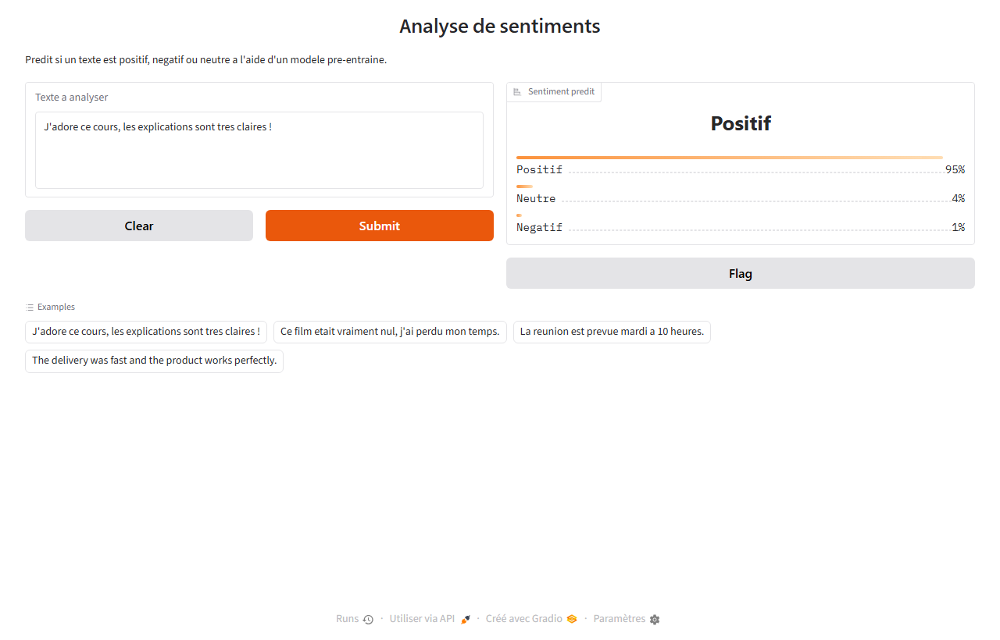

# Framework d'Implémentation des Projets IA

Travaux pratiques du cours *Framework d'Implémentation des Projets IA*
(Master Intelligence Artificielle, Université de Nouakchott, 2026-2027).

## Travaux pratiques

| TP | Sujet | Dossier |
|---|---|---|
| TP 1 | Classification de sentiments avec Gradio (Cours 2) | [tp1/TP_Gradio_Sentiments](tp1/TP_Gradio_Sentiments) |

## TP 1 : Classification de sentiments avec Gradio

Application web Gradio qui prédit si un texte (français ou anglais) est **positif**, **négatif** ou **neutre**,
avec le modèle pré-entraîné `cardiffnlp/twitter-xlm-roberta-base-sentiment` (Hugging Face).

**👉 Tester l'application en ligne : https://huggingface.co/spaces/teyebsidi/analyse-sentiments**

- Code : [app.py](tp1/TP_Gradio_Sentiments/app.py), [tester.py](tp1/TP_Gradio_Sentiments/tester.py)
- Captures d'écran : [captures/](tp1/TP_Gradio_Sentiments/captures)

### Résultats (`python tester.py`)

| Texte | Attendu | Prédit | Confiance |
|---|---|---|---|
| J'adore ce cours, les explications sont très claires ! | Positif | Positif | 95,1 % |
| Ce film était vraiment nul, j'ai perdu mon temps. | Négatif | Négatif | 96,7 % |
| La réunion est prévue mardi à 10 heures. | Neutre | Neutre | 69,0 % |
| The delivery was fast and the product works perfectly. | Positif | Positif | 86,3 % |
| I'm really disappointed with the customer service. | Négatif | Négatif | 95,5 % |
| Génial, encore une panne de réseau… | Négatif (ironie) | Négatif | 84,7 % |



### Lancer le projet

```
cd tp1/TP_Gradio_Sentiments
python -m venv venv
venv\Scripts\activate
python -m pip install -r requirements.txt
python app.py        # puis ouvrir http://127.0.0.1:7860
```
